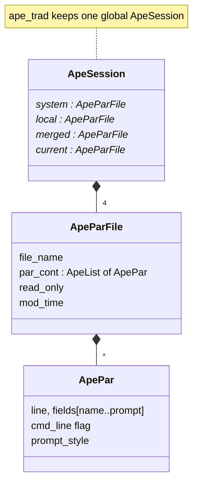

# ape Architecture

**ape** (All-purpose Parameter Environment, written by James Peachey at
HEASARC/GSFC) is the C library that reads, prompts for and writes the
IRAF-style parameter files (`<tool>.par`) used by every Fermitools `gt*`
tool. It replaces the older HEASoft PIL library and keeps a PIL-compatible
API (`pil.h`). The Fermitools copy is a vendored snapshot of the HEASARC
code with a Fermi-specific CMake build.

Fermi code never calls ape directly. The chain is
`st_app::AppParGroup` → `hoops::ParPromptGroup` → `ape_trad_*` (see
`src/hoops/doc/architecture/`).

**The behaviour users see — PFILES, local versus system par files, modes,
prompting and learning — is described in
[parameter-files.md](parameter-files.md).** Read it before changing a par
file or debugging "why did the tool use that value?".

## Purpose and scope

**Does:**
- Locate `<tool>.par` on the local and system halves of `PFILES`, merge the
  user's local copy with the installed system copy, and write the user's
  copy back with "learned" values.
- Parse tool command lines (`name=value`, positional values, `name+`/`name-`,
  abbreviated names).
- Prompt on stdin/stdout according to each parameter's mode, and validate
  values against type, range and enumeration.
- Convert values to C types (`ape_trad_get_double`, `..._long`, etc.).
- Provide the `p*` command-line utilities for inspecting and editing par
  files.
- Provide a PIL-compatible API (`PILInit`, `PILGetReal`, …) and Fortran
  bindings through `cfortran.h`.

**Does not:**
- Provide C++ types or exceptions. That is `hoops`.
- Know anything about the Fermitools. Fermi par files live in each tool's
  package under `pfiles/` and are installed by that package.
- Do readline line editing. Readline support is compiled out (see
  [Build and test](#build-and-test)).

## Position in the system

| Direction | Package | Why |
|-----------|---------|-----|
| Depends on | — | Only libc. No Fermi packages and no externals. |
| (Disabled) | readline | `find_package(READLINE)`, the link and `USE_READLINE` are all commented out in `CMakeLists.txt` (commit `b8792b1`, "Drop Readline dependency", 2025). The code paths still exist under `#ifdef USE_READLINE` in `src/ape_util.c`. |
| Used by | `hoops` | The only direct client: `src/hoops_ape.cxx` includes `ape/ape_error.h`, `ape_io.h`, `ape_list.h`, `ape_par.h` and `ape_trad.h`. No other package includes `ape/` or `pil.h`. |
| Used by (runtime) | every `gt*` tool | Indirectly, through `hoops` and `st_app`. |

ape sits at the very bottom of the parameter stack:

```
gt* tool ─ st_app::AppParGroup ─ hoops::ParPromptGroup ─ HoopsApeFile/HoopsApePrompt ─ ape_trad_* ─ ape_session ─ ape_io / ape_par
```

## Key abstractions

All public headers are C, with `extern "C"` guards. They live in
`include/ape/` plus `include/pil.h` and `include/pil_error.h`.

| Module | Header | Role |
|--------|--------|------|
| `ape_trad` | `ape/ape_trad.h` | "Traditional" XPI/PIL-like API over **one global session** (`s_default_session` in `src/ape_trad.c`). `ape_trad_init(argc, argv)`, `_query_*` (prompt if the mode requires it), `_get_*` (no prompt), `_set_*`, `_save`, `_close(save_flag)`. This is what hoops uses. |
| `ape_session` | `ape/ape_session.h` | The same API with an explicit `ApeSession *`, so that several par files can be open at once (added in ape 2.7). Holds four `ApeParFile`s: `system`, `local`, `merged` (system + local) and `current` (merged + command line). |
| `ape_io` | `ape/ape_io.h` | `ApeParFile` (file name, list of `ApePar`, `read_only`, `mod_time`). PFILES parsing, path search, read, atomic write, merge, command-line application, revert of unlearned values. |
| `ape_par` | `ape/ape_par.h` | `ApePar`: one line of a par file (or a comment). Fields (`eName`…`ePrompt`), type and mode codes, effective mode, value conversion, range checks and prompting. |
| `ape_util` | `ape/ape_util.h` | String helpers, string-to-number conversion (`ape_util_s2*`), env-var expansion, file-access checks, prompt-style defaults, `atexit` registration, and `ape_util_interpret_env` (`APEDEBUG`, `HEADASNOQUERY`). |
| `ape_list` | `ape/ape_list.h` | Minimal doubly linked list (`ApeList`, `ApeListIterator`) used for everything. |
| `ape_msg` | `ape/ape_msg.h` | Error, info and debug output. Streams can be redirected (`ape_msg_set_err_stream`, `ape_msg_set_out_stream`). |
| `ape_error` | `ape/ape_error.h` | `enum` of status codes (`eOK`, `eFileNotFound`, `eParNotFound`, `eTypeMismatch`, `eNewParameter`, …). Every function returns one of these. |
| `ape_binary` | `ape/ape_binary.h` | Implementations of `pget`, `pset`, `plist`, `pquery`, `pquery2`, `punlearn` and `pcheck`. |
| `ape_par_group` | `ape/ape_par_group.h` | A small container of parameters, not used by Fermi code. |
| `ape_test` | `ape/ape_test.h` | Test-harness helpers. The unit tests themselves are `ape_*_test()` functions inside each `.c` file. |
| PIL compatibility | `pil.h`, `pil_error.h` | `PILInit`, `PILGet*`, `PILPut*`, `PILClose`, `PILOverrideQueryMode`, `PILSetReprompt`, … implemented in `src/pil.c` on top of `ape_trad`. |



## Data flow and control flow

A `gt*` run, as hoops drives it (details of each step are in
[parameter-files.md](parameter-files.md)):

```
ape_trad_init(argc, argv)                         // called by hoops for every Load/Prompt/Save
  └─ ape_session_init
       ├─ ape_util_interpret_env()                // APEDEBUG, HEADASNOQUERY
       ├─ (closes and SAVES any previous global session)
       ├─ get_pfile_name(argv[0]) → "<tool>.par"
       ├─ ape_io_read_file_path(sys path)  → system
       ├─ ape_io_read_file_path(local path) → local   (else clone system, named <first local dir>/<tool>.par)
       ├─ ape_io_merge_par_files(system, local) → merged
       ├─ clone merged → current; ape_io_apply_command_line(current, argv+1)
       └─ ape_io_check_file_format(current, no value check)
ape_trad_query_double("emin", &x)
  └─ ape_par_query: effective mode 'q'? → prompt on stdout / fgets(stdin), validate, reprompt
  └─ ape_session_save                              // the file is written after every query
ape_trad_close(1)
  └─ ape_session_save: clone current, ape_io_revert_unlearned(vs merged), ape_io_write (tmp file + rename)
```

The `p*` utilities follow the same path through `ape_trad_init`, or call
`ape_io_read` directly when given a par-file path (`-f`, or an argument
that contains `/` and ends in `.par`).

## Public interfaces

### C API

- `ape/ape_trad.h`: the API to use. hoops uses `ape_trad_init`,
  `ape_trad_close`, `ape_trad_get_current`, `ape_trad_query_{bool,double,long,string,file_name}`
  and `ape_trad_set_{bool,double,long,string,file_name}`, plus `ape_io_get_par_cont`,
  `ape_list_*` and `ape_par_get_field`/`ape_par_get_comment` to enumerate
  the parameters.
- `ape/ape_session.h`: the same API for multiple simultaneous files. Not
  used in the Fermitools.
- `pil.h`: PIL compatibility for legacy C code. Not used in the Fermitools.

All functions return an `int` status from `ape/ape_error.h`. Strings
returned through `char **` must be freed by the caller with `free()`.

### Applications

| Executable | Source | Purpose |
|------------|--------|---------|
| `pget` | `src/pget/pget.c` | Print parameter values. |
| `pset` | `src/pset/pset.c` | Set parameter values in the local par file. |
| `plist` | `src/plist/plist.c` | List all parameters. |
| `pquery` | `src/pquery/pquery.c` | Query one parameter; save without reverting unlearned values. |
| `pquery2` | `src/pquery2/pquery2.c` | Query one parameter; save with normal learning. |
| `punlearn` | `src/punlearn/punlearn.c` | Reset the local par file to the system copy. |
| `pcheck` | `src/pcheck/pcheck.c` | Validate a par file. |

Each `main` is a one-liner that calls `ape_binary_<name>(argc - 1, argv + 1)`.
Usage is summarized in [parameter-files.md](parameter-files.md#the-command-line-utilities).
The `src/*/<tool>.html` files are the original HEASoft help pages. They
are not installed.

ape has no par files of its own.

### Python

None.

### File formats

IRAF/HEASoft parameter files (`.par`), described in
[parameter-files.md](parameter-files.md#the-par-file-format).

## Build and test

ape's CMake layout differs from the other Fermi packages because it was
made into a standalone CMake project (commit `cb5615c`, "Version 3"):

- `CMakeLists.txt` calls its own `project(ape VERSION 3 LANGUAGES C)`.
- Headers are in `include/` (not `ape/` at the top level), and there is a
  `cmake/` directory with `Config.cmake.in` and an unused
  `FindREADLINE.cmake`.
- **Targets:** `ape`, a shared library with `OUTPUT_NAME ape_3`
  (`libape_3.so`), and the alias `ST::ape`. The seven `p*` executables link
  `ST::ape`.
- **Install:** it does **not** use the `FERMI_INSTALL_*` variables.
  Headers go to `${CMAKE_INSTALL_INCLUDEDIR}/ape/` plus `pil.h` and
  `pil_error.h` directly in `include/` (not `include/fermitools/`). The
  library goes to `lib/` and the executables to `bin/`. It installs its own
  export set `apeTargets` (namespace `ST::`) with `apeConfig.cmake` under
  `lib/cmake/ape`, instead of joining `fermiTargets`.
- `export(PACKAGE ape)` is a no-op under the `cmake_minimum_required(3.18)`
  policy defaults (CMP0090) unless `CMAKE_EXPORT_PACKAGE_REGISTRY` is set.
- The module-path lines refer to `${CMAKE_SOURCE_DIR}/cmake`, which is the
  **umbrella's** `cmake/` in a ScienceTools build. With the `find_package`
  commented out, they have no effect.
- C standard: the umbrella sets `CMAKE_C_STANDARD 17` and PIC on.
- `include/cfortran.h` is compiled in (`ape_trad.c` and `pil.c` always
  define the Fortran wrappers) but is not installed.

**Tests:**
- The unit tests are compiled **into the library**. `src/ape_test.c` is in
  the `ape` source list, and every module has an `ape_<module>_test()`
  function. The driver, `src/test/ape_test_main.c`, is **not built** by
  CMake, and nothing is registered with CTest. ape has no automated tests
  in the Fermitools build.
- To run the HEASARC test by hand, build `src/test/ape_test_main.c` against
  `libape_3`, then follow `src/test/README.test`. In short: `PFILES` must be
  unset; copy `src/test/unix-ref/ape_test.par` to `ape_test_unix.par`,
  `ape_test_win32.par` (DOS newlines) and `pfiles/ape_test.par` in a scratch
  directory; feed `src/test/ape_test-input` on stdin; compare the output
  with `src/test/unix-ref/ape_test-log`. The test writes files into the
  current directory.
- **CI:** there is no `azure-pipelines.yml` in this package. ape is built
  only as part of the umbrella ScienceTools CI.

## Invariants and gotchas

**Global state**
- `ape_trad` uses one process-wide session. `ape_trad_init` silently
  **closes and saves** any session that is already open. hoops depends on
  this: it opens and closes the session around every `Load`, `Prompt` and
  `Save`. Code that needs two par files open at once must use
  `ape_session_*`.
- `PFILES` is read once and cached (`s_par_path` in `ape_io.c`). Changing
  the environment variable after the first ape call has no effect unless
  `ape_io_set_pfiles(0)` is called.
- `ape_io_set_pfiles` always returns `eOK`, even if parsing the new value
  failed (`create_paths` status is ignored).

**Where files are written**
- A new local copy goes to the **first** directory of the local path. With
  the default conda activation (`PFILES=".:$HOME/pfiles;…"`) that is the
  **current working directory**, unless the file already exists in
  `~/pfiles` (see
  [parameter-files.md](parameter-files.md#practical-consequences-for-fermitools-users-and-developers)).
- If `PFILES` has an empty local part (e.g. `";/path/syspfiles"`), the
  system file is cloned **without** `read_only` and keeps its own path, so
  learned values are written back into the **system** par file if that
  directory is writable (`ape_session_init`, `else if (eOK ==
  system_status)` branch). From reading the code; not checked at runtime.
  The `read_only` flag is only ever set in `ape_io_merge_par_files` for a
  system-only merge, and `ape_session_init` never takes that path.
- Every query saves the file, and so does `ape_trad_close(1)`. Save
  failures are reported through `ape_msg_error` but otherwise ignored by
  `ape_trad_close`.

**Values**
- Reals are written with `"%1.15g"` (`ape_session_set_double`) and floats
  with `"%1.7g"`. 15 significant digits is not enough for an exact double
  round trip.
- A system file that is newer than the local copy resets **hidden**
  parameters to the system values on the next run. Non-hidden learned
  values are kept. The release notes for 2.5 describe this as "take the
  current value from the system file" without the hidden-only restriction.
  The code (`par_synch`) is the authority.
- Names on the command line may be abbreviated to any unique prefix. Adding
  a parameter whose name is a prefix of an existing one, or shares a prefix
  that users abbreviate, can break existing command lines with "ambiguous
  parameter name" errors.

**Prompting**
- Prompts go to stdout and input is read with `fgets` from stdin. Without
  readline there is no line editing or history at prompts.
- `HEADASNOQUERY` (any value) disables all prompting. `APEDEBUG` turns on
  debug messages.

**Documentation**
- `doc/release-notes` stops at ape 2.7 (2010). The code has later changes
  (for example the 2015 `ape_util_override_query_mode` refactor in
  `ape_util.c`), and the CMake project calls itself version 3. Use the git
  history and the `$Log$` blocks at the end of each source file.
- `README.md` at the package root is a placeholder.

## Extension points

- **New `gt*` tool or parameter:** nothing to do in ape. Add or edit the
  `.par` file in the owning package's `pfiles/` directory.
- **New parameter type or value syntax:** `ape_par.c` (type table near the
  `"b", "d", "f", "fe", …` list, `ape_par_check`, the `ape_par_get_*`
  converters) and `ape_util_s2*` in `ape_util.c`. hoops would then need a
  matching branch in `HoopsApeFile::Save`, `HoopsApePrompt::Prompt` and
  `Par::ConvertFrom`.
- **New utility:** add an `ape_binary_<name>` function in `ape_binary.c`,
  a `src/<name>/<name>.c` `main`, and an `add_executable` plus install
  entry in `CMakeLists.txt`.
- **Re-enabling readline:** uncomment the three READLINE lines in
  `CMakeLists.txt`, and add readline back to the conda recipe's run
  requirements (the umbrella `recipe/meta.yaml` still pins `readline`).

ape is vendored HEASARC code. Prefer keeping local changes small and
recording them in the commit message, so that it can still be compared with
upstream HEASoft ape.

## Further reading

- [parameter-files.md](parameter-files.md): PFILES, merging, modes,
  prompting, learning and the `p*` tools.
- `src/hoops/doc/architecture/README.md`: the C++ layer that Fermi code
  uses.
- `src/*/<tool>.html`: original HEASoft help for `pget`, `pset`, `plist`,
  `pquery`, `pquery2` and `punlearn`.
- `src/test/README.test`: how the HEASARC unit test is run.
- `doc/release-notes`: history up to ape 2.7.
- HEASoft's own documentation of parameter files and of ape, which is
  upstream for this package.
